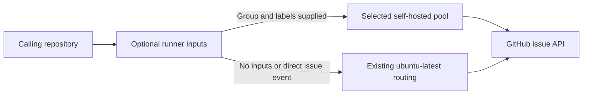

# .github

This repository contains **organisation-level defaults** for GitHub issue templates and related settings.  
These defaults apply across the organisation, but can be **overridden in an individual repository** by adding repo-specific templates under `.github/ISSUE_TEMPLATE/`.

## Which issue/template type should I use?

See the [Issue/Template Advice page](./ISSUE_TEMPLATE_ADVICE.md) for guidance.

## Select runners for reusable issue workflows

The issue guidance and Feature-to-Epic workflows accept these optional inputs:

| Input | Default | Meaning |
| --- | --- | --- |
| `runner-group` | Empty | Restrict routing to this group when supplied. |
| `runner-labels` | `["ubuntu-latest"]` | JSON array of required labels. |

Existing callers and direct issue events keep their current hosted routing.
A caller can opt into its existing self-hosted pool:

```yaml
jobs:
  guide:
    uses: AssetCool/.github/.github/workflows/_autocomment-advice.yml@<reviewed-commit-SHA>
    with:
      runner-group: Jetson
      runner-labels: '["self-hosted", "Jetson"]'
```

The same inputs apply to `_autolink-feature-to-epic.yml`. Supply a valid JSON
array; malformed JSON fails routing rather than falling back. Runner group
access must already allow the caller repository. These workflows run only
GitHub API scripts; they do not check out issue-author-controlled code.



### Verify and roll back

Use Python 3.12 with the committed uv lock and Node 22 for expression checks:

```bash
uv sync --locked
uv run --locked python -m unittest discover -s tests -v
```

YAML follows two-space indentation; Markdown uses CommonMark/GFM, following the
AssetCool coding standards wiki. The tests parse workflows, exercise default,
explicit, escaped-group and malformed-JSON routing, and preserve event and
permission contracts. actionlint validates workflow expression syntax.

The `Validate runner routing` workflow uses only self-hosted Jetson runners.
Writers can dispatch it on a completed feature branch to trust that revision;
it also checks relevant pushes to main. There is no PR event on this workflow:
a PR can change its own workflow definition, so job conditions are insufficient
to protect persistent runners from untrusted PR code.
If a selected group is unavailable, jobs wait; there is no hosted fallback for
an explicit self-hosted selection. To recover, restore the caller's previous
reviewed workflow reference and inputs together. This change is proposed until
its PR is merged and consumers select the resulting reviewed commit.
